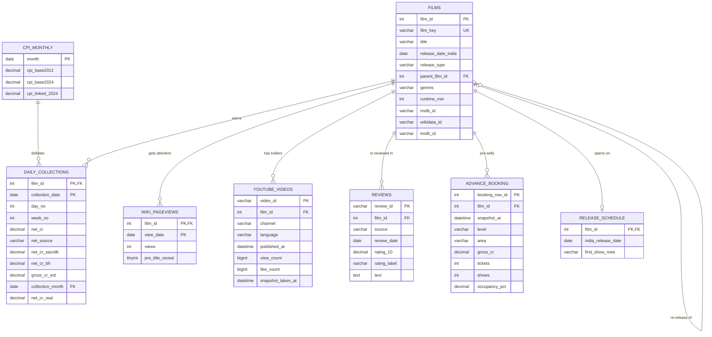

# ER diagram

Design notes
- `film_key` is the cleaned title key; all raw spellings are mapped to it in `src/utils.py::match_film`.
- `daily_collections` has a composite key (film, date) - one number per film per day; both trade sources are kept as columns, `net_cr` is the chosen value and `net_source` says where it came from.
- `collection_month → cpi_monthly.month` is how inflation adjustment is joined (query Q8). It is NULL for Nov-2026 days because that CPI is not published yet.
- `films.parent_film_id` links the Encore re-release to the original film.
